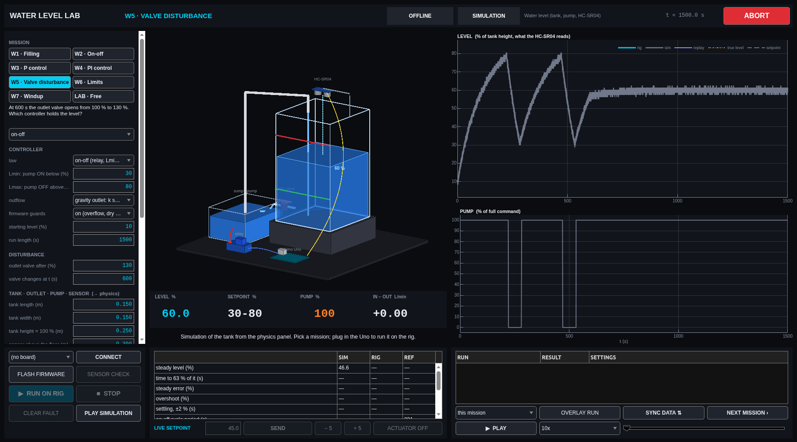
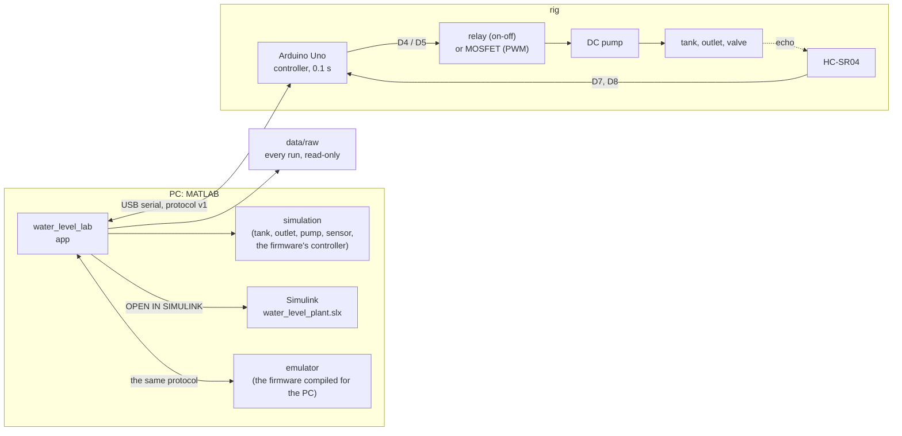

# Arduino water level control lab: tank, DC pump, HC-SR04, relay, MATLAB and Simulink

**On-off, P and PI level control of a pumped tank with an Arduino Uno, an HC-SR04 ultrasonic
sensor and a relay (or a MOSFET for PWM): firmware with overflow and dry-run guards, a MATLAB
lab app whose physics comes from your tank, outlet and pump, a Simulink model with the Relay
block, and an end-to-end test against an emulated rig.**

[](https://github.com/Samarth030312/arduino-water-level-control-lab/actions/workflows/ci.yml)


A small DC pump fills a tank; water leaves through an outlet at the bottom, faster the fuller the
tank is. An ultrasonic sensor above the water times its echo. An Arduino switches the pump through
a relay (on below Lmin, off above Lmax) or drives it with PWM through a MOSFET (P, PI). A MATLAB
app simulates all of it from the tank, outlet and pump you describe, runs the same controller on
the rig, records it, and draws one over the other.

If you are building this rig, this repository takes you from parts to a measured control loop.
If you are not, the simulator and the Simulink model teach the same ideas: a nonlinear,
self-regulating plant, the limit cycle of on-off control, the offset of P, integral action,
saturation and windup, and why a guard belongs in the firmware.

<p align="center"></p>

## Get it running

Paste this into the MATLAB Command Window, on Windows, macOS or Linux (MATLAB R2023b or newer):

```matlab
gitclone("https://github.com/Samarth030312/arduino-water-level-control-lab.git", Depth=1); cd arduino-water-level-control-lab; setup open
```

It downloads the repository, checks the computer, installs the project's own Arduino toolchain the
first time (about 60 MB, hash-checked, no admin rights) and opens the app. The simulator needs
only MATLAB. Terminal one-liners and the CH340 driver: **[install](install/README.md)**. Then,
step by step: **[the sequence](docs/SEQUENCE.md)**.

## What the model says, before the rig

With the default rig (a 15 L jar, 24 × 24 cm, an 8 mm drain, a 0.5 HP-class mains pump at
25 L/min; ESTIMATED until you measure yours; worked out in [first principles](docs/FIRST_PRINCIPLES.md)):

- **The jar regulates itself, but the pump overwhelms it.** The drain's outflow grows with √h
  (2.2 L/min at 30 %, 3.7 L/min at 80 %), so a fixed inflow would settle at h = (q/k)²; the pump
  delivers six times more, and left on it fills the empty jar to the rim in under a minute. Linearised,
  the jar is a first-order lag of 4–6.5 minutes, longer the fuller it is.
- **On-off between 30 % and 80 %** fills in about 22 s and drains in about 2.6 minutes: a cycle of
  ~3 minutes, 22 pump starts an hour; the level overshoots Lmax by ~4 % (water still in the pipe).
- **The pump can only be switched**, not throttled: P and PI need a PWM pump. In simulation, P
  leaves an offset (the drain needs a pump command, and P gives one only with an error), PI removes
  it, and clamping stops the integrator winding up while the pump is saturated.
- **The firmware guards the pump and the floor**: overflow, no filling (dry suction), run time,
  lost sensor, silent host, a hung program, and at most ~200 starts an hour ([wiring](docs/hardware/WIRING.md)).

Rig sessions will be added under [results](results/README.md); every number above will then be
checked against the rig, as in the [DC servo lab](https://github.com/Samarth030312/rhino-rmcs-2303-dc-servo-control).

## Start here

| I want to … | Go to |
|---|---|
| understand the simulator, Simulink, the emulator and the rig | [how it works](docs/HOW_IT_WORKS.md) |
| run everything, in order | [the sequence](docs/SEQUENCE.md) |
| install it on Windows, macOS or Linux | [install](install/README.md) |
| use the app, no hardware needed | [the app guide](docs/guide/README.md) |
| run the Simulink model | [Simulink](docs/SIMULINK.md) |
| build and wire the rig | [replicate the rig](docs/REPLICATE.md) and [wiring](docs/hardware/WIRING.md) |
| understand the physics | [first principles](docs/FIRST_PRINCIPLES.md) |
| read the results | [results](docs/RESULTS.md) |
| use the data | [data](data/README.md) |
| fix a problem | [troubleshooting](docs/TROUBLESHOOTING.md) |
| follow the ENR312 course (Ahmedabad University) | [course guide](docs/course/README.md) |
| see what comes next | [roadmap](ROADMAP.md) |

## How it fits together



## Status

- **Firmware:** on-off through the relay, P and PI through PWM, the air temperature for the speed
  of sound, guards against overflow (92 %), dry run and a silent PC, an optional float switch;
  compiles in CI on Windows, macOS and Linux; runs against an emulated tank, pump and sensor.
- **App and Simulink:** missions W1–W7 and LAB, end-to-end tested against the emulated rig.
- **Not yet on a real rig.** The physics values are ASSUMED until you measure your tank and pump.

## Repository layout

```
setup.m      one command: path, checks, toolchain, the app (setup open)
firmware/    the Arduino sketch, and the same sketch compiled for the PC against an emulated tank
matlab/      app, physics, controller, metrics, the Simulink model, tests
data/        every rig run (raw CSV, metadata, RUN_REGISTER.csv)
results/     reports and figures
docs/        how it works, physics, hardware, guide, course guide, knowledge base
install/     one-line set-up for Windows, macOS, Linux
```

## Related

Same lab family, same app design: [Rhino DC servo lab](https://github.com/Samarth030312/rhino-rmcs-2303-dc-servo-control) ·
[Arduino temperature control lab](https://github.com/Samarth030312/arduino-temperature-control-lab) ·
[STEVAL-EDUKIT01 rotary inverted pendulum](https://github.com/Samarth030312/steval-edukit).

## License

MIT ([`LICENSE`](LICENSE)). Course handouts are cited, not redistributed.
