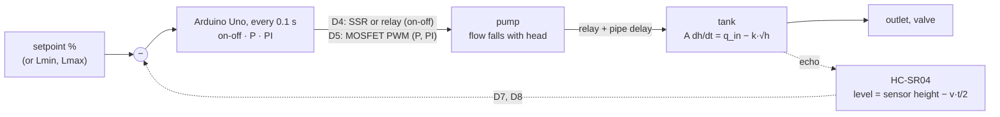
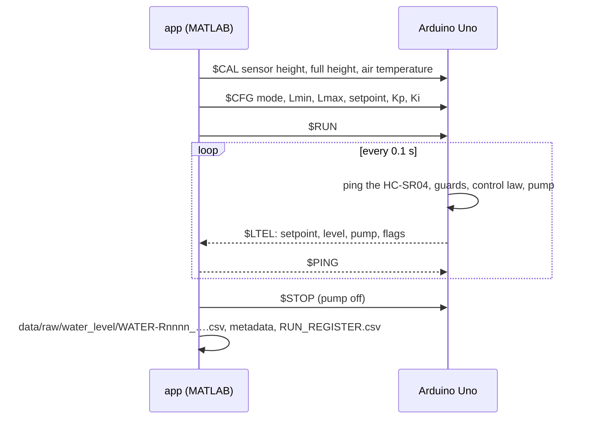

# How it works

Four things can run the same experiment: the **simulator** in the app, the **Simulink** model,
the **emulator** (the real firmware compiled for the PC), and the **rig**.

## The loop

What makes this plant interesting for control, all of it in the model:

- **It regulates itself, nonlinearly.** The outflow grows with √h, so every pump command has its
  own resting level, and the tank is faster near the bottom than near the top.
- **The pump can only fill.** Emptying is the outlet's job; the pump also has a dead zone at low
  PWM and gives less flow against a higher head.
- **The sensor measures distance, not level.** It needs the sensor's height above the floor and
  the air temperature (the speed of sound); ripples make it noisy.
- **Things go wrong with water.** The firmware guards against overflow (above 92 %), against a
  dry run (pumping hard for a minute without the level rising) and against a silent PC.

## Four ways to run one experiment

| | What it is | Use it to |
|---|---|---|
| **Simulator** | MATLAB, inside the app: the tank, outlet, valve, pump curve and dead zone, the delay, the sensor, the firmware's guards and controller laws | learn the concepts without hardware; predict a rig run |
| **Simulink** | `water_level_plant.slx`, generated from code: the tank as an integrator, the Relay block for on-off, a Discrete PID for P / PI; **OPEN IN SIMULINK** builds it with the app's settings | see and change the block diagram ([Simulink](SIMULINK.md)) |
| **Emulator** | the sketch compiled with g++ against an emulated tank, pump and HC-SR04, in real time on a pseudo-terminal (or faster) | test the firmware and the app together without a rig; CI does |
| **Rig** | the Uno, the relay or MOSFET, the pump, the tank, the sensor | measure |

## A run, from button to file

Protocol: [serial protocol](architecture/SERIAL_PROTOCOL.md). Pins: [wiring](hardware/WIRING.md).
