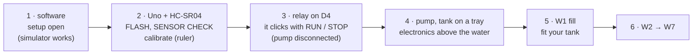

# Replicate the rig

## Parts

| Part | What the lab uses | Notes |
|---|---|---|
| Controller | Arduino Uno (a CH340 clone works; Windows needs its driver, see [install](../install/README.md)) | |
| Sensor | HC-SR04 ultrasonic, mounted square above the water | minimum range about 2 cm: mount it above the full level |
| Tank | a 15 L jar with a drain near the bottom (24 × 24 cm, 100 % = 26 cm in the defaults), filled from a larger reservoir that the drain returns to | measure it: every level and flow depends on it |
| Pump | the lab's: a 0.5 HP-class 230 V monoblock pump (25 L/min assumed); or a small 12 V DC pump | a mains pump needs an earthed, RCD-protected, fused socket ([wiring](hardware/WIRING.md)) |
| Switch | a solid-state relay for a mains pump (lab: Fotek SSR-40DA, on-off); a relay module (on-off); a logic-level MOSFET for a DC pump (P, PI by PWM) | chosen in the app's physics panel; it sets the firmware build |
| Optional | a float switch at the top (D3): hardware overflow stop; a valve on the outlet | |
| PC | Windows, macOS or Linux, MATLAB R2023b or newer (Simulink optional) | |

## Build, in this order

1. `setup open`; play the missions in simulation.
2. The Uno and the HC-SR04 ([wiring](hardware/WIRING.md)). Type the sensor height and the tank's
   size in the physics panel, **FLASH FIRMWARE**, CONNECT, **SENSOR CHECK** at five levels or more
   against a ruler (`docs/experiments/calibration_template.csv`, `levellab.level.calibrate`).
3. The relay on D4 with the pump **disconnected**: RUN in W2 below Lmin, the relay clicks on;
   STOP turns it off. If it works the wrong way round, your module is active-HIGH: rebuild with
   `-DRELAY_ACTIVE_LOW=0`.
4. The pump through the relay, its own supply fused; the tank on a tray; every electronic part
   above the water line.
5. **W1**: a fixed pump command from empty; type the outlet and pump until SIM matches RIG.
6. W2 to W7 ([the sequence](SEQUENCE.md)); P and PI need the MOSFET on D5.

Before any run: [experiment checklist](safety/EXPERIMENT_CHECKLIST.md).
