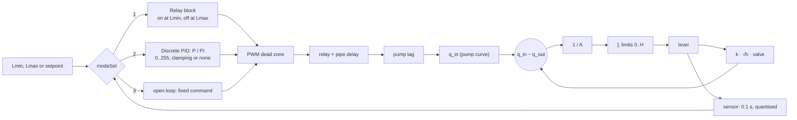

# Simulink model

`matlab/models/water_level/water_level_plant.slx`, generated by `build_level_simulink` (so it can
be reviewed, diffed and rebuilt). Parameters live in the **model workspace** and are set by
`run_level_simulink(cfg)` from the same configuration the app simulates.

## From the app

**OPEN IN SIMULINK** builds the model with the current mission's controller, thresholds or
setpoint, gains, valve step and the physics panel's tank, outlet and pump, and opens it. Run it,
change blocks freely, rebuild with the button to get the app's version back.

## From a script

```matlab
setup
c = levellab.level.defaultConfig();              % the physics panel's defaults
c.mode = 'ONOFF';                                % or 'P', 'PI'
R = run_level_simulink(c);                       % Simulink: R.t, R.level, R.meas, R.q
S = levellab.level.simulate(c);                  % the same loop in MATLAB
```

`matlab/tests/test_simulink_model.m` runs on-off, P and PI in both and checks they agree: the
on-off period within 3 %, the steady error of P and PI within 0.5 %.

## Blocks



The outflow can also be set to constant (a pumped drain: a pure integrator) to compare the two
kinds of tank. The overflow and dry-run guards are in the firmware and the MATLAB model only.

For the ENR312 Simulink assignments on water level, see the [course guide](course/README.md).
