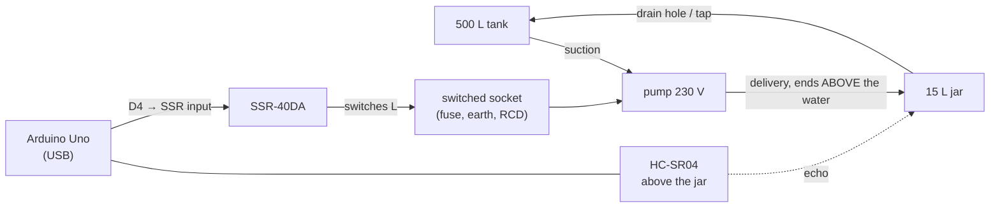

# Wiring: a mains pump through an SSR, an HC-SR04, an Arduino Uno

The lab rig: a **500 L tank** (the reservoir) → a **0.5 HP-class single-phase monoblock pump**
(yellow, Silver brand; nameplate not yet read) → a **15 L jar** (the controlled tank) → a drain
back into the 500 L tank. The pump is switched by a **Fotek SSR-40DA** solid-state relay (input
3–32 V DC, load 24–380 V AC, zero-cross), the level is measured by an **HC-SR04** ultrasonic
sensor above the jar, and an **Arduino Uno** on USB runs the firmware (`firmware/level_controller`,
built with the defaults: on-off, SSR active-HIGH).

> **Mains and water together can kill.** The pump runs on 230 V and stands in a wet place.
> Its metal body **must be earthed**, the socket **must be protected by a 30 mA RCD (RCCB)**,
> and nothing on the mains side may be touched while it is plugged in. Have the lab technician
> check the mains side before the first power-up.



## 1. Low-voltage side (5 V, from the Uno's USB)

| From | To on the Uno | Notes |
|---|---|---|
| SSR **3 (+)** | **D4** | D4 HIGH = pump ON. The SSR's input needs ~10 mA at 5 V: fine for a pin. |
| SSR **4 (−)** | **GND** | any GND pin (not AREF) |
| HC-SR04 **VCC** | **5V** | |
| HC-SR04 **GND** | **GND** | |
| HC-SR04 **TRIG** | **D8** | |
| HC-SR04 **ECHO** | **D7** | the Uno is 5 V: direct |
| float switch (optional) | **D3** and GND | closes when water reaches it: a hardware stop independent of the ultrasonic reading |
| push button (optional) | **D12** and GND | start/stop without MATLAB |

The firmware's other output (D5, PWM) is not used with an SSR.

## 2. Mains side: a switched socket

Do **not** cut into the pump. Build (or have the technician build) a small **switched socket box**:
the pump's own plug goes into it, so the pump keeps its factory wiring and its earth.

```
 wall socket (RCD 30 mA)                         switched socket box
   L ──── fuse 6.3 A (T) ──── SSR 1 ~ ║ SSR 2 ~ ──── socket L ─┐
   N ─────────────────────────────────────────────── socket N  ├── pump's plug
   E (green/yellow) ──────────────────────────────── socket E ─┘   (pump body earthed)
```

- **Live (L) through the SSR**, as on the temperature rig. Neutral and earth go straight through.
  Find L at the plug's terminal marked **L** (not by colour).
- **Earth must reach the pump's body**: the earth pin of the socket box, through the pump's own
  3-pin plug, to the earth screw in its yellow terminal box. Check continuity with a meter: pump
  body to the plug's earth pin, under 1 Ω.
- **RCD 30 mA**: plug the box into an RCD-protected socket or a portable RCD adapter. Press its
  TEST button before each session.
- **Fuse**: 6.3 A slow-blow (T) in the live line, or a 6 A C-curve MCB. A 0.5 HP pump draws about
  2.5–4 A running and 5–7 times that for a fraction of a second when it starts.
- **SSR on a heatsink**: at ~3.5 A the SSR dissipates ~1.5 V × 3.5 A ≈ 5 W; on its own plastic
  case it overheats. Screw it to an aluminium heatsink (or a 3 mm aluminium plate of at least
  10 × 10 cm) with thermal paste. After the first runs, touch-test the heatsink (power off): warm
  is fine, too hot to hold is not.
- **Surge suppressor (recommended)**: a 275 V AC varistor (MOV, e.g. 14D431K) across SSR terminals
  1 and 2. A motor is an inductive load; the MOV absorbs switching spikes that shorten an SSR's life.
- **Rating**: the SSR-40DA is rated 40 A resistive; for motors use at least 4× the running current
  (met here). Unbranded "Fotek" relays are common and often weaker than marked: the heatsink matters.
- The SSR leaks up to ~3 mA when off: the pump stays still, but its socket is **not** dead.
  Unplug before touching anything on the mains side.
- Keep the box, the SSR, the Uno and the laptop **above and away from the water**, on a board,
  with drip loops in the cables (they hang below the box before rising into it).

## 3. Plumbing and the jar

- **Suction**: from the 500 L tank to the pump's inlet. A self-priming pump still needs its
  casing filled with water before the first start (unscrew the priming plug on top, fill, close).
  **Never run it dry**: the firmware stops it if the level does not rise (section 6), but a dry
  pump is damaged within minutes.
- **Delivery into the jar: end the pipe ABOVE the highest water level.** A pipe ending under
  water siphons the jar back through the stopped pump into the 500 L tank (monoblock pumps have
  no check valve). Point the jet at the jar wall, away from the space under the sensor: splashes
  and foam under the HC-SR04 give false readings.
- **Drain (outflow)**: the course needs water leaving the jar (cycles, Q_out). Drill a hole of
  6–10 mm near the bottom, or fit a small tap, with a tube back into the 500 L tank. Measure its
  diameter: it sets the outflow (`d_out` in the app), and a tap lets you change it (the disturbance).
- Stand the jar level and stable; a full 15 L jar weighs 15 kg.

## 4. The levels: minimum and maximum

All levels are percentages of the water depth you call 100 %. For a 15 L jar (about 24 × 24 cm
inside, ~30 cm to the rim: **measure yours**):

| Level | Rule | Why |
|---|---|---|
| **rim** | the top of the jar | water above it spills next to mains equipment |
| **100 %** | **3 cm or more below the rim** | margin for the overshoot and ripples |
| **sensor face** | **2–4 cm above the rim**, pointing straight down, centred | the HC-SR04 cannot measure closer than ~2 cm; the firmware treats water within 4 cm of the sensor as an overflow |
| **overflow guard** | **92 %** (firmware; `$GRD` changes it) | the pump is forced off above it, whatever the controller says |
| **overshoot** | ≈ Q_in × t_delay / A ≈ 417 mL/s × 1.5 s / 576 cm² ≈ **1.1 cm ≈ 4 %** | water still arriving after the pump stops (pipe, run-down): Lmax + 4 % and 92 % + 4 % stay under 100 % |
| **Lmax** | **80 %** (course) | pump OFF above it |
| **Lmin** | **30 %** (course) | pump ON below it; keep at least ~3 cm of water so the surface, not the floor, returns the echo, and keep the drain covered |
| **0 %** | the jar floor | `$ZERO` with the jar empty measures the sensor height |

The HC-SR04's cone (about ±15°) widens to ~16 cm across at 30 cm: keep its view of the water clear
of the jar's neck, the inlet pipe and the jar walls (mount it centred over the widest part).

## 5. Bring-up, in this order

1. **Low voltage only, pump unplugged.** In the app: pump wiring *mains AC pump · SSR*, FLASH
   FIRMWARE, CONNECT. The level appears.
2. **Measure and enter the geometry** in the app's physics panel: jar inside length and width,
   sensor face to jar floor (`h_sensor`), the depth you call 100 % (`tank_H`), the drain bore.
   The app sends them to the board at each run. (In the Serial Monitor, `$ZERO,1` with the jar
   empty measures the sensor height.)
3. **Check the reading**: pour in water to a ruler-measured depth at three levels; the app's level
   must match within ~0.5 cm (the full calibration: five levels and a fitted line).
4. **SSR without the pump**: on-off run with Lmin above the current level: the SSR's LED lights;
   STOP: it goes out.
5. **Mains side checked** by the technician (section 2), the casing primed (section 3), the drain open.
6. **First pump run, a person at the wall switch**: on-off 30–80 %, watch one full cycle. Be ready
   to switch off at the wall if the level passes 90 %.

## 6. What the firmware does by itself

| Guard | Default | Action |
|---|---|---|
| overflow | level > 92 %, water within 4 cm of the sensor, or the float switch closed | pump off at once |
| no filling | pump on, level rises less than 1 cm in 20 s | pump off, latched (dry suction, empty reservoir, blocked or broken pipe) |
| run time | pump on 180 s without reaching Lmax | pump off, latched (drain too big, leak, sensor fault) |
| sensor | 5 failed pings in a row | pump off, latched |
| host | MATLAB silent for 3 s while it controls | pump off |
| program hang | the AVR watchdog resets the Uno after 2 s | after any reset D4 is LOW: pump off |
| motor | at least 3 s on and 15 s off between switchings | anti short-cycling: at most ~200 starts an hour even with a 0 % band |
| not calibrated | geometry never set | RUN refused |

A latched fault stays until STOP (CLEAR FAULT in the app). P and PI are refused with an SSR: an
induction motor behind a zero-cross SSR cannot be speed-controlled (it switches only whole mains
half-cycles, and a motor fed that way hums, heats and loses torque). They remain available in
simulation, and on the rig with a DC pump on a MOSFET (build `PUMP_PWM=1`).
