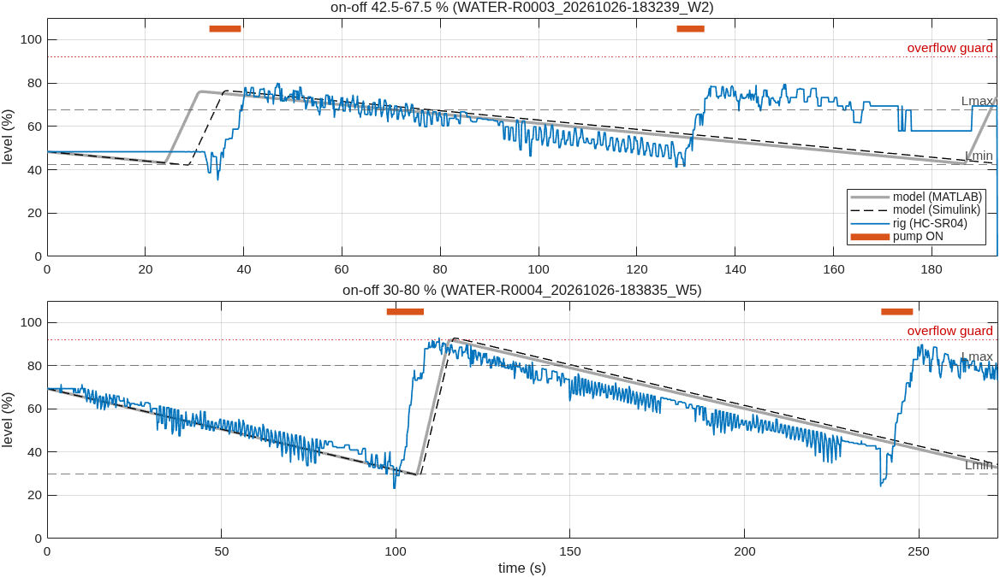
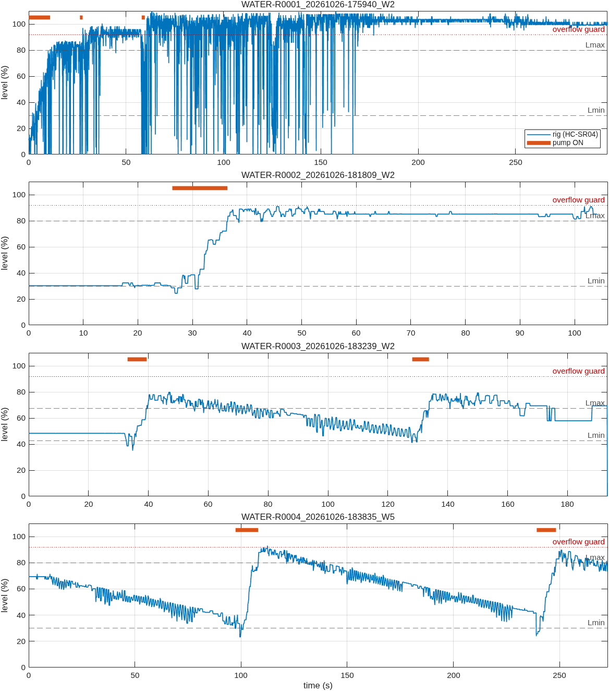

# Water-level control: rig session 2026-10-26

Generated by `matlab/scripts/level_session_report.m` from `data/` (4 runs). A 15 L jar filled from a 500 L tank by a 0.5 HP-class single-phase pump switched by a Fotek SSR-40DA, an HC-SR04 above the jar, an Arduino Uno running `firmware/level_controller` (on-off, guards on). Levels are percent of the depth entered as 100 %; the jar's inside dimensions are ESTIMATED (24 x 24 cm), so flows in L/min carry that uncertainty, while times and rates in cm/s do not.

**Observation.** The jar has no drain yet: during R0003 and R0004 the operator emptied it by hand while the pump was off, so the outflow is neither constant nor Torricelli's; the model takes it as the constant mean rate measured in each run. After R0002 the operator suspected a loose HC-SR04 connection and re-seated it.

## The runs
| run | mission | band sent (%) | sensor height / 100 % (cm) | firmware | length (s) | pump starts | ended |
|---|---|---:|---:|---|---:|---:|---|
| `WATER-R0001_20261026-175940_W2` | W2 | 30-80 | 39.6 / 20.0 | 28601cd | 297 | 9 | ABORTED: board unplugged |
| `WATER-R0002_20261026-181809_W2` | W2 | 30-80 | 34.2 / 22.0 | e300af3 | 106 | 1 | ABORTED: by the operator |
| `WATER-R0003_20261026-183239_W2` | W2 | 42.5-67.5 | 34.2 / 22.0 | b7da4bf | 193 | 2 | STOPPED: the level readings jump more than the water can move: check the sensor's view |
| `WATER-R0004_20261026-183835_W5` | W5 | 30-80 | 34.2 / 22.0 | b7da4bf | 273 | 2 | ABORTED: by the operator |

## The sensor, as the firmware reported it
The firmware pings once every 100 ms and reports the median of the last five accepted pings; a ping more than 3 cm (plus 2 cm/s of elapsed time) from that median is rejected as an echo the water could not have produced. A level that holds for many frames therefore means either a still surface or rejected pings.

| run | frames | frames whose level changed | steps > 1.5 cm, pump off | lost echoes (level NaN) | ripple about the trend, longest pump-off stretch (cm, 1 sigma) | its dominant period (s) |
|---|---:|---:|---:|---:|---:|---:|
| `WATER-R0001_20261026-175940_W2` | 2972 | 2377 (80 %) | 690 | 0 | 1.15 | 0.2 |
| `WATER-R0002_20261026-181809_W2` | 1061 | 159 (15 %) | 1 | 19 | 0.37 | 5.2 |
| `WATER-R0003_20261026-183239_W2` | 1934 | 473 (24 %) | 16 | 0 | 0.65 | 1.1 |
| `WATER-R0004_20261026-183835_W5` | 2726 | 920 (34 %) | 38 | 0 | 0.64 | 1.2 |

## On-off cycles
| run | band (%) | cycles | rise, pump ON (cm/s) | fall, pump OFF (cm/s) | Q_in (L/min) | Q_out (L/min) | T_on (s) | T_off (s) | period (s) | overshoot past Lmax (cm) | equivalent delay (s) |
|---|---:|---:|---:|---:|---:|---:|---:|---:|---:|---:|---:|
| `WATER-R0001_20261026-175940_W2` | 30-80 | (2) | 0.94 | -0.162 | - | - | - | - | - | - | - |
| `WATER-R0003_20261026-183239_W2` | 42.5-67.5 | 1 | 1.07 | 0.047 | 38.6 | 1.63 | 6.1 | 89 | 95 | 2.8 | 2.6 |
| `WATER-R0004_20261026-183835_W5` | 30-80 | 1 | 1.51 | 0.083 | 55.2 | 2.86 | 10.0 | 131 | 141 | 2.8 | 1.8 |

A run whose level did not fall with the pump off (no outflow) has no real cycles: its switchings are shown in brackets and not analysed. Q_out = jar area x fall rate; Q_in = jar area x rise rate + Q_out. The overshoot is the highest level after each switch-off minus Lmax, averaged over the complete cycles; dividing it by the rise rate gives the time the level kept rising after the pump was switched off (the pipe emptying, the run-down, the waves).

### Against the formulas and the model
| run | T_on = A dL / (Q_in - Q_out) (s) | T_on, rig (s) | T_on, MATLAB / Simulink (s) | T_off = A dL / Q_out (s) | T_off, rig (s) | T_off, MATLAB / Simulink (s) | overshoot, rig / MATLAB (cm) | MATLAB vs Simulink, RMS (cm) |
|---|---:|---:|---:|---:|---:|---:|---:|---:|
| `WATER-R0003_20261026-183239_W2` | 5.1 | 6.1 | 6.9 / 7.1 | 117 | 89 | 156 / - | 2.8 / 1.6 | 1.16 |
| `WATER-R0004_20261026-183835_W5` | 7.3 | 10.0 | 9.1 / 9.3 | 133 | 131 | - / - | 2.8 / 2.6 | 0.38 |

- : the run ended before the model completed that phase. The model runs each run's own band from its own starting level, with the pump flow and the outflow measured in that run, the firmware's guards and minimum times, and the ESTIMATED 1.5 s from switch-on to water arriving. Where the rig's overshoot exceeds the model's, the water kept arriving longer than 1.5 s after the switch-off, or the waves from the jet lifted the reading.

## Every run

## Runs stopped before their end
- `WATER-R0001_20261026-175940_W2`: ABORTED: board unplugged
- `WATER-R0002_20261026-181809_W2`: ABORTED: by the operator
- `WATER-R0003_20261026-183239_W2`: STOPPED: the level readings jump more than the water can move: check the sensor's view
- `WATER-R0004_20261026-183835_W5`: ABORTED: by the operator
